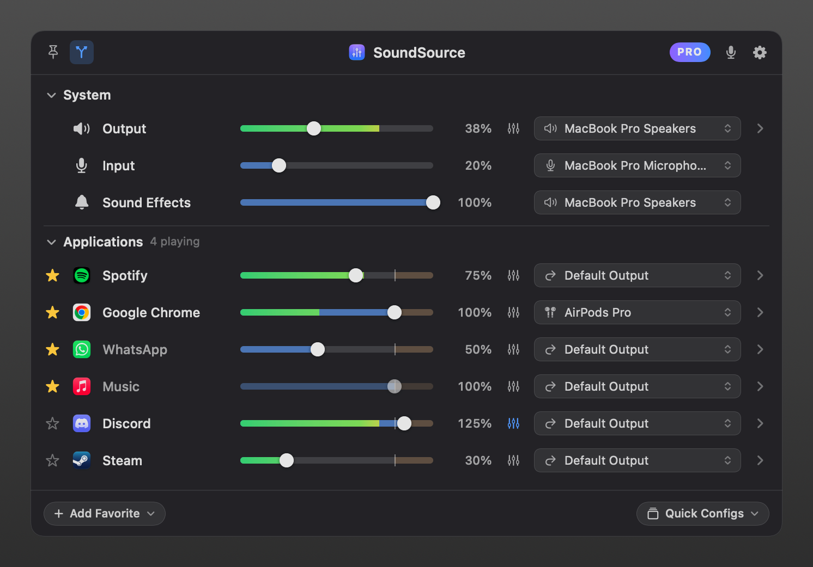

# SoundSource Clone

A native macOS menu bar app modelled on Rogue Amoeba's SoundSource: system output/input/alert
volume and device selection, plus **per-app volume (0–200 %), mute, balance, 10-band EQ and
per-app output routing**. Swift 5 language mode, SwiftUI + AppKit, no kernel extension or audio driver.



## How per-app audio works

macOS 14.2 added **Core Audio process taps** (`CATapDescription`, `AudioHardwareCreateProcessTap`).
For every app that plays audio, the engine builds this chain:

```
app processes ──▶ process tap (stereo mixdown, muteBehavior = .mutedWhenTapped)
                         │
private aggregate device = [target output device] + [tap]   (tap drift-compensated)
                         │  IOProc on the real-time thread:
                         │  tap input → gain → EQ → balance → soft clip → meter
                         ▼
                 target output device  (system default, the app's own device, or a chosen route)
```

* The tap mutes the app at its source **only while our IOProc is reading**. If this app stalls,
  quits or crashes, the HAL destroys the tap and the app's audio is untouched.
* Routing an app to another device only rebuilds the aggregate; the tap stays in place.
* Chrome/Electron helpers and Safari's WebKit GPU process are grouped under their app using the
  "responsible process" SPI (the one TCC uses), with an outermost-`.app`-bundle fallback.
* The DSP (`StereoProcessor`) never allocates or locks on the IO thread. Parameters cross threads
  through preallocated memory, and the EQ coefficients are double-buffered.

| Layer | Files |
|---|---|
| Entry point, status item, floating panel | `App/SoundSourceApp.swift`, `App/AppDelegate.swift`, `App/MenuBarController.swift`, `App/FloatingPanel.swift` |
| Core Audio helpers, devices, system volume | `Audio/CoreAudioSupport.swift`, `Audio/AudioDevice.swift`, `Audio/AudioDeviceManager.swift`, `Audio/AlertVolume.swift` |
| Per-app capture | `Audio/AudioProcessMonitor.swift`, `Audio/AppIdentityResolver.swift`, `Audio/ProcessTapSession.swift`, `Audio/StereoProcessor.swift`, `Audio/CapturePermission.swift` |
| Orchestration and persistence | `Audio/AudioEngine.swift`, `Model/*` |
| SwiftUI panel | `UI/*` (custom sliders and meters in `UI/Components/VolumeSlider.swift`, NSMenu-backed pickers in `UI/Components/PopUpMenuButton.swift`) |

## Get a ready-to-install DMG from GitHub (browser only, no Terminal)

`.github/workflows/build.yml` builds the app on GitHub's macOS 26 runner as a universal binary
(Apple silicon + Intel), packages `SoundSource-Clone.dmg` and attaches it to a GitHub Release.

1. **Upload the project.** On github.com click **+ › New repository**, name it, and create it
   with nothing added (no README). On the empty repository page click **uploading an existing
   file**. In Finder, open this folder and press **⌘⇧.** (Command-Shift-Period) so the hidden
   `.github` folder shows. Select everything (**⌘A**), drag it onto the page, wait for the file
   list, then click **Commit changes**. Check that `.github/workflows/build.yml` appears in the
   repository. If it doesn't, use **Add file › Create new file**, type
   `.github/workflows/build.yml` as the name, paste the file's contents, and commit.
2. **Build it.** Open the **Actions** tab. If asked, click the button to enable workflows. Choose
   **Build DMG** on the left, click **Run workflow** (you can type a version such as `1.0.0`), then
   the green **Run workflow** button. The run takes a few minutes and ends with a green check.
3. **Download it.** On the repository's **Code** tab, click **Releases** in the right sidebar,
   open the newest release, and click **SoundSource-Clone.dmg**. Open it and drag
   **SoundSource Clone** onto **Applications**.

**First launch.** Without signing secrets the build is ad-hoc signed, so macOS blocks the first
launch. Click **Done**, then open **System Settings › Privacy & Security** and click **Open
Anyway** (once). Then click **Allow** for System Audio Recording. To have it start by itself
from then on, turn on **Launch at Login** in the panel's gear menu.

Pushing a tag such as `v1.2.0` also builds and publishes a release. Every run also keeps the DMG
as a downloadable artifact on its run page. Releases in a public repository can be downloaded by
anyone. macOS runner minutes are free for public repositories; private repositories use the
plan's included minutes, which macOS jobs consume faster than Linux jobs.

### Optional: no security warning at all (Developer ID + notarization)

This needs a paid Apple Developer Program membership. Add these under the repository's
**Settings › Secrets and variables › Actions › New repository secret**. The workflow detects them
and signs, notarizes and staples the DMG:

| Secret | Where to get it (no Terminal) |
|---|---|
| `DEVELOPER_ID_CERTIFICATE_P12` | Create a *Developer ID Application* certificate at developer.apple.com (Keychain Access › Certificate Assistant makes the request file), install it, then in Keychain Access › My Certificates right-click it › **Export** as `.p12`. Base64 it with the Shortcuts app: *Select File* → *Base64 Encode* (Line Breaks: None) → *Copy to Clipboard*. |
| `DEVELOPER_ID_CERTIFICATE_PASSWORD` | The password you chose during that export |
| `APPLE_TEAM_ID` | developer.apple.com › Account › Membership details |
| `NOTARY_API_KEY_P8` | appstoreconnect.apple.com › Users and Access › Integrations › App Store Connect API: generate a key, download the `.p8`, open it in TextEdit and copy everything |
| `NOTARY_KEY_ID`, `NOTARY_ISSUER_ID` | Shown on that same API keys page |

## Requirements

* macOS **14.2** or later (14.4+ recommended; that's where the System Audio Recording permission exists)
* Xcode **16** or later (the project uses folder-synchronised groups)

## Run it (included project)

1. Open `SoundSourceClone.xcodeproj`.
2. Select the **SoundSourceClone** target › **Signing & Capabilities** › choose your **Team**.
   It builds without one ("Sign to Run Locally"), but then macOS forgets the audio permission
   after every rebuild because the ad-hoc signature changes.
3. Press **⌘R**. A speaker icon appears in the menu bar. There is no Dock icon (`LSUIElement`).
4. On first launch, allow **System Audio Recording**. If you dismissed the prompt, go to
   System Settings › Privacy & Security › Screen & System Audio Recording ›
   *System Audio Recording Only* and enable **SoundSource Clone**. The panel also shows a
   **Grant Access** button.
5. Play something (Spotify, a YouTube tab). It appears under **Applications** within a moment.

> Quit Rogue Amoeba's SoundSource and its Audio Routing Kit (`arkaudiod`) while you test.
> Two per-app audio engines intercepting the same apps will fight each other.

Command-line build:

```bash
xcodebuild -project SoundSourceClone.xcodeproj -scheme SoundSourceClone -configuration Release build
```

## Recreating the project from scratch in Xcode

If you'd rather start from Xcode's template:

1. **File › New › Project › macOS › App**. Interface *SwiftUI*, language *Swift*, product name
   `SoundSourceClone`.
2. Delete the generated `SoundSourceCloneApp.swift` and `ContentView.swift`. Drag the
   `SoundSourceClone/` source folder from this repo into the project ("Create folders").
   `App/SoundSourceApp.swift` contains the `@main` entry point.
3. **General** › Minimum Deployments: **macOS 14.2**.
4. **Build Settings**:
   * *Swift Language Version* → **Swift 5**
   * *Default Actor Isolation* → **nonisolated**. Xcode 26 templates default to MainActor, which
     would isolate the real-time render code to the main thread and break the IOProc.
   * *Info.plist File* → `Config/Info.plist`, and *Generate Info.plist File* → **No**
     (or add the keys below to the target's **Info** tab instead).
5. **Info.plist keys** (all already in `Config/Info.plist`):

   | Key | Value | Why |
   |---|---|---|
   | `LSUIElement` (Application is agent) | `YES` | Menu bar only, no Dock icon or main menu |
   | `NSAudioCaptureUsageDescription` | purpose string | Required for process taps. Without it, tap creation fails |
   | `NSMicrophoneUsageDescription` | purpose string | Only for the optional microphone level meter |

6. **Signing & Capabilities**:
   * Remove **App Sandbox**. Private aggregate devices and process taps are meant for
     non-sandboxed, Developer ID–distributed apps (SoundSource isn't on the Mac App Store either).
   * Keep **Hardened Runtime** and tick **Resource Access › Audio Input**
     (`com.apple.security.device.audio-input`, used by the optional mic meter).
   * Or point *Code Signing Entitlements* at `Config/SoundSourceClone.entitlements`.
7. Build & run.

## Using it

* **Header**: pin (keep the panel open when clicking elsewhere), routing toggle (show or hide the
  per-app device column), PRO / Trial Mode badge (cosmetic; switch it in Settings), microphone
  quick-mute, and a gear menu (Settings, Launch at Login, About, Quit).
* **System**
  * *Output*: hardware volume with a live meter (loudest captured app), system EQ (applied to
    every captured app), default output device, and a chevron for sample rate and balance.
  * *Input*: input gain and default input device. The level meter is opt-in in Settings, because
    reading the mic lights the orange indicator.
  * *Sound Effects*: alert volume (via Standard Additions) and the alert output device.
* **Applications**: star to favorite (favorites stay listed when not running), click the app icon
  to mute, slider 0–200 % with a detent at 100 % (the area past the tick is boost), EQ button,
  output route picker, and a chevron for balance, status, reset and Show in Finder. Double-click
  any slider to reset it.
* **Bottom bar**: *Add Favorite* (running apps or *Choose Application…*) and *Quick Configs*
  (save, apply or delete snapshots of app settings, system devices and volumes, and the system EQ).
* **Settings › Capture**: *All apps that play audio* (default; gives every app a meter) or
  *Only apps I adjust* (apps at 100 % with no EQ or route are left untouched).

Settings persist in `UserDefaults` under `SoundSourceClone.state.v1`.

## Debug helpers

```bash
# Read-only: list devices, default devices, volumes, permission state and process → app grouping
SoundSourceClone.app/Contents/MacOS/SoundSourceClone --diagnose

# Render the panel with sample data to a PNG (no Core Audio access)
SoundSourceClone.app/Contents/MacOS/SoundSourceClone --snapshot panel.png [--expanded]

# Launch with per-app peak levels logged every 2 s (while the panel is closed)
open -n SoundSourceClone.app --args --log-levels

# Open the panel at launch; --dump-panel also writes the live panel's view hierarchy to a PNG
open -n SoundSourceClone.app --args --show-panel
open -n SoundSourceClone.app --args --dump-panel /tmp/panel.png
```

Only one copy runs at a time. Launching a second one (another build, or Xcode while a copy is
already running) opens the running copy's panel and quits. Quit the running copy first if you
want to debug in Xcode.

Capture events (permission, start, reroute, stop, failures) and the stream layout of each
aggregate go to the unified log:

```bash
/usr/bin/log stream --style compact --predicate 'subsystem == "com.example.SoundSourceClone"'
```

Use `/usr/bin/log` in zsh, where a bare `log` is a shell builtin.

SwiftUI previews (`#Preview` in `PopoverRootView.swift`) use the same sample data.

## Known limitations

* System EQ only reaches captured apps. Audio from uncaptured processes (system sounds, daemons)
  bypasses it.
* Devices without hardware volume (many HDMI/DisplayPort outputs) show the system slider as
  unavailable. Per-app sliders still work on them.
* Output devices that also have microphones (USB or Bluetooth headsets) are added to the aggregate
  with their input streams disabled through `kAudioDevicePropertyIOProcStreamUsage`, so Bluetooth
  headsets shouldn't drop into hands-free mode. Test this with your own headset.
* If an app goes silent while captured (for example DRM-protected playback that a tap can't read),
  reset that app or switch Settings › Capture to *Only apps I adjust*.
* Capture permission is checked through the private TCC SPI, loaded with `dlopen` like
  insidegui/AudioCap does. If Apple removes the SPI, the app falls back to the system prompt
  that appears when the first tap is created.
* "SoundSource" is a Rogue Amoeba trademark. Rename the app before sharing or distributing it.
# SoundSource
